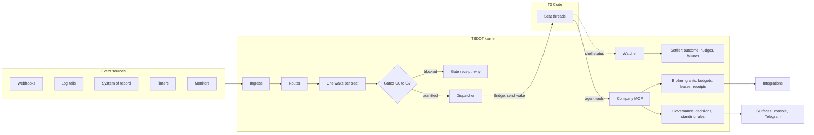
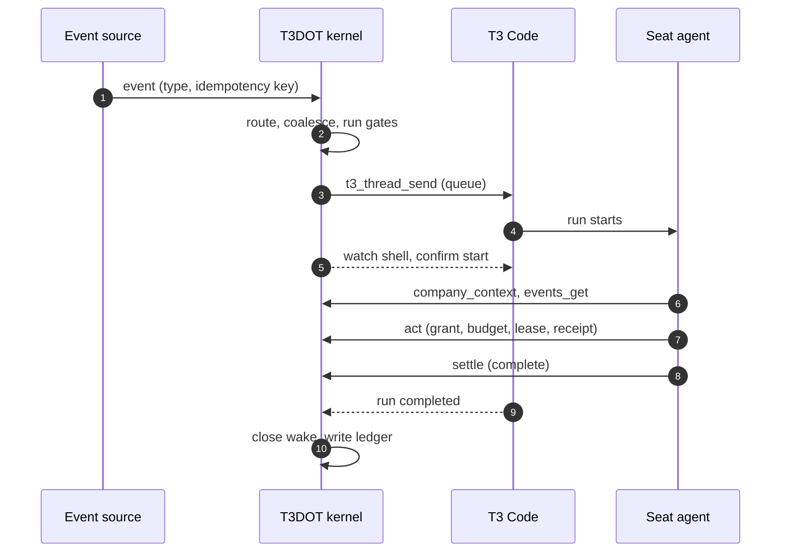

# T3DOT

**A small company kernel for teams of AI agents, running beside [T3 Code](https://github.com/pingdotgg/t3code).**

> [!NOTE]
> **Status: proposal.** This repository holds a design, a configuration schema and a config validator. The kernel itself is not built yet. Feedback is welcome: open an issue.

> [!IMPORTANT]
> **Independent project.** T3DOT is not affiliated with, sponsored by or endorsed by T3 Tools, Inc. "T3" and "T3 Code" are trademarks of T3 Tools, Inc. and appear here only to describe compatibility. T3 Code is © T3 Tools, Inc. and MIT-licensed. See [NOTICE.md](NOTICE.md).

T3 Code runs coding agents such as Claude Code and Codex in threads you can drive from the web, desktop and mobile. Run a whole team of agents on it, with a lead agent, specialists, scheduled jobs and scripts feeding them work, and you start needing the parts T3 Code deliberately leaves out:
- who is on the team;
- what wakes whom;
- what each agent may do on its own;
- what needs a human;
- what it all costs.

T3DOT is that layer:
- It decides **when** a seat (a role bound to a T3 thread) should act and checks that it **may**.
- It sends the wake into the seat's thread, watches the run, and requires a declared outcome.
- It brokers the agents' external effects (messages, posts, deploys, spend), and records decisions, receipts and usage.

It does not replace T3 Code's apps, store transcripts or run LLM monitors. People keep chatting with their agents in T3 Code.

## Why

Agent teams run on prompts and timers alone break in predictable ways:

- **Heartbeats that mostly say "nothing changed".** Polling a lead agent every 15 minutes spends 96 model turns a day.
- **Wakes that fail silently.** A dead webhook or a parked queue leaves work waiting for hours, and nobody is told.
- **Threads that grow until they break.** Long-lived coordination threads slow down, then fail.
- **Rules that live only in prompts.** Send caps, quiet hours and "ask the owner first" get waived under pressure, and scripts forget to check HALT files.
- **Shared logins without real locks.** Two agents driving one browser session collide.
- **Approvals scattered through chat,** with no record of what exactly was approved.

These come from running always-on agent teams at Fretron, at BuildRun and on a side project. [The story behind T3DOT](STORY.md) tells how the project started.

## How it works



1. **Events in.** Event sources post typed **events**: webhooks, log tails, the system of record, timers and monitors.
2. **One pending wake per seat.** The **router** maps each event to a **seat** and folds it into that seat's single pending **wake**.
3. **Gates, in a fixed order:** pause, seat, capacity, engine health, thread state, budget, preconditions, leases. A blocked wake leaves a receipt saying why, and no model turn runs.
4. **Dispatch through the Bridge.** The **dispatcher** sends a short wake packet into the seat's T3 thread and confirms that the run started.
5. **The agent acts through the company MCP:** `company_context`, `events_get`, `work`, `settle`, `decide`, `act`, `timer` and `lease`. External effects go through the **broker**: grant, budget, lease token and an idempotent receipt.
6. **Every wake ends with `settle`:** complete, block, defer, progress or ack. If it doesn't, the seat is nudged twice, then the work item is blocked and the presenter is told.

One event, end to end:



## Two ways to adopt

| | Full mode | Bridge mode |
|---|---|---|
| **For** | Orgs whose agents already live in T3 Code threads, held together by scripts, schedules and prompts | Orgs that already run their own agent kernel: org chart, work items, approvals, a broker |
| **What runs** | The T3DOT kernel plus the Bridge | The org's own kernel, with the Bridge as a new executor |
| **What it gains** | A control plane: wakes on events, gates, budgets, leases, decisions, a ledger | T3 Code's apps, and much less runner, sandbox and transcript code to maintain |

## Key ideas

- **One way in.** Only the dispatcher sends to T3, and only for wakes that passed every gate.
- **One pending wake per seat.** Events coalesce, so a burst of 10 messages is one turn, not 10.
- **Every open item has a next mover:** a run, a timer, a decision, a human, other work or an expected event. A sweep catches anything without one within 5 minutes.
- **A project can have its own seat.** A work seat lives for one goal, project or job. Its thread rotates, it wakes when all its children finish or one is blocked, and it retires at close-out.
- **Approvals are pinned to content.** A decision approves an exact content hash. "Approve and always allow" creates a bounded, revocable standing rule. Some decisions, such as prices and money moves, are floors that only a human can make.
- **Grants, budgets and leases are enforced in the broker, not in prompts.** Leases carry fencing tokens, so two agents can't both hold a browser profile.
- **The kernel never writes business records.** It reacts to the system of record's events; the owning seats write.
- **Pause is central.** One switch stops admission and makes the broker refuse writes, for agents and scripts alike.
- **Brand is a dimension, not an install.** One company can run several brands that share a phone line, a payment account or a deployment.

## What's in this repository

| Path | What |
|---|---|
| [`STORY.md`](STORY.md) | How T3DOT started: agent teams at Fretron and BuildRun, T3 Code, and Paperclip |
| [`blueprint/BLUEPRINT.md`](blueprint/BLUEPRINT.md) | The design: concepts, invariants, architecture, data model, lifecycles, the T3 Bridge, governance, security, operations, testing and the build plan. Appendix A lists every T3 Code behaviour the design relies on, with source paths |
| [`blueprint/GLOSSARY.md`](blueprint/GLOSSARY.md) | How T3DOT's terms map to the Marketing OS and Paperclip, and what came from each |
| [`blueprint/CONFIG.md`](blueprint/CONFIG.md) | Configuration reference |
| [`blueprint/schema.json`](blueprint/schema.json) | JSON Schema for a company configuration |
| [`blueprint/examples/minimal/`](blueprint/examples/minimal/) | The smallest complete configuration |
| [`tools/validate.mjs`](tools/validate.mjs) | Validates a configuration: schema, cross-references and safety rules |

## Try the validator

Needs Node.js 20 or later.

```sh
npm install
npm run validate -- blueprint/examples/minimal
```

A configuration is a directory of YAML files. Besides the schema, the validator checks that:
- every reference resolves;
- reporting lines have no cycles;
- floor decisions have only human deciders;
- no seat that reads untrusted inbound content holds an outbound send grant (the "Rule of Two");
- no profile runs at a higher runtime mode than the kernel's T3 credential allows.

## Relationship to T3 Code

- **No fork, no patches.** T3DOT uses T3 Code's public MCP and HTTP interfaces and its provider-instance settings.
- **Version-pinned.** Some behaviours it depends on are internal and unversioned. A contract test suite gates every T3 Code upgrade (blueprint §7.9).
- **Upstream ideas go through T3's process.** A few small T3 Code improvements would simplify T3DOT: failure and usage data on thread reads, thread identity for MCP servers, and waits that return on pending questions. They'll be raised with the T3 Code maintainers through their contribution process before any pull request.

## Roadmap

| Milestone | What | Done when |
|---|---|---|
| M0 Skeleton | Store, config loader and validator, CLI, revisions | Configs validate; `config apply` and `rollback` work |
| M1 Shadow | Ingest, route and gate, but wake nothing; log would-wakes | 7 days with ≥95% of real seat actions matched within 2 minutes |
| M2 Live, one seat | Bridge, dispatcher, company MCP, nudges, failure kinds, engine health | Dispatch-to-start p90 ≤2 min, max ≤10 min; no lost wakes |
| M3 Time and resources | Timers, expectations, leases with fencing | No silent skips; timer heartbeats retired |
| M4 Broker | Grants, budgets, receipts, pause through the broker | One send budget per line across every sender; pause stops every brokered write |
| M5 Governance and money | Decisions, surfaces, standing rules, ledger, automatic rotation, work seats | Pinned decisions; budget holds fire; a project's seat retires at close-out |
| M6 Records and knowledge | Record adapter, doctrine built from a knowledge base | The kernel writes no business records |
| M7 OS-user split | Kernel and broker secrets out of the agents' reach | A file-read probe from a seat can't read any broker secret |

Details are in [blueprint §15](blueprint/BLUEPRINT.md#15-build-plan).

## Prior art

[Paperclip](https://github.com/paperclipai/paperclip) (MIT, Paperclip Labs) runs teams of agents as a company, with an org chart, budgets and tickets. T3DOT takes several of its ideas: a single admission path, receipts for skipped wakes, a next-mover check, typed failures, a cost ledger and "always allow" rules. Both keep timer heartbeats off by default and coalesce wakes. They differ on purpose:
- agents don't check out their own work; routes assign it;
- comments, assignments and status changes don't wake an agent directly; every wake goes through a configured route and the same gates;
- decisions go through a presenter and are pinned to their content; there are no per-call "ask first" prompts;
- humans see decisions, not a feed of alerts;
- T3DOT doesn't run agents itself; T3 Code does.

T3DOT also draws on the Agentic Marketing OS, an internal agent team at Fretron described in [STORY.md](STORY.md). [GLOSSARY.md](blueprint/GLOSSARY.md) maps T3DOT's terms to both.

## Contributing

This is an early proposal, so design discussion is the most useful contribution. Open an issue with questions, objections or a use case the design doesn't cover. For changes to the schema or validator, run `npm test` before opening a pull request.

## License

MIT. See [LICENSE](LICENSE). Third-party and trademark notices are in [NOTICE.md](NOTICE.md).
